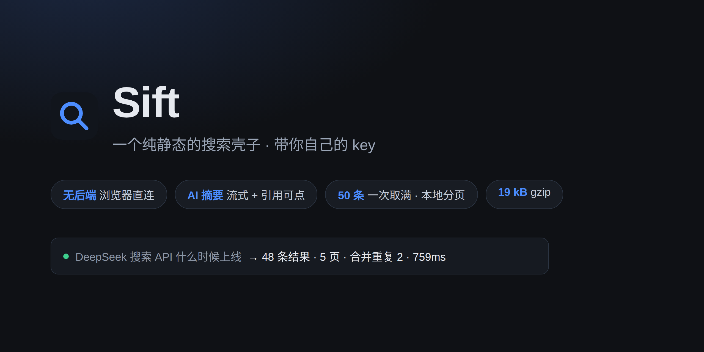
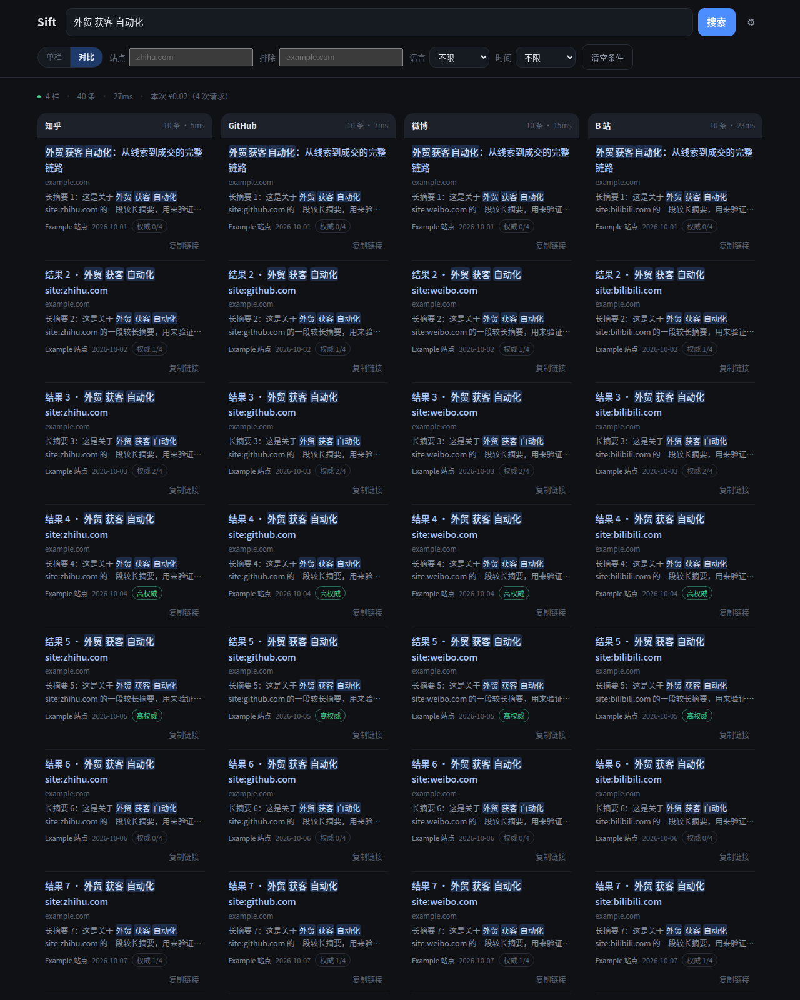
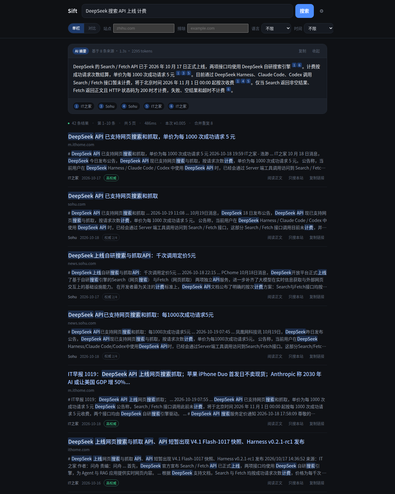
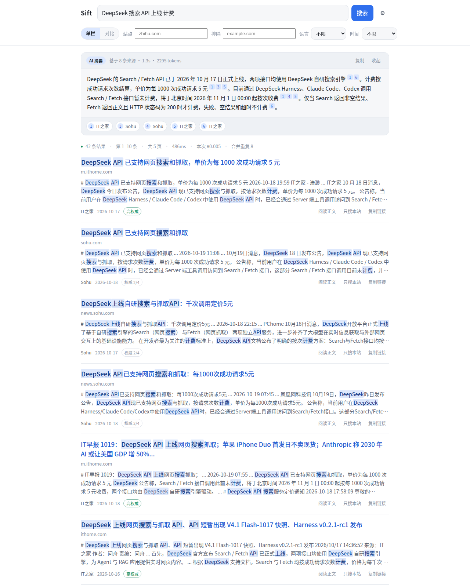
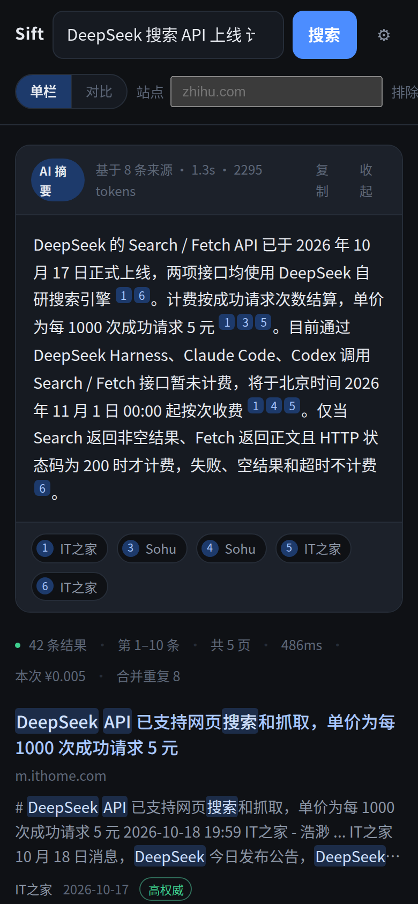

# Sift


一个纯静态的搜索壳子：带你自己的 DeepSeek API Key，浏览器直连搜索接口，答案是带引用的
AI 摘要，不是十条蓝色链接。




> **不是 DeepSeek 官方产品**，与深度求索无隶属关系。**BYOK**：API Key 只存在你自己的浏览器
> `localStorage` 里，不上传、不经任何中间服务器。

## 目录

- [这是什么](#这是什么)
- [快速开始](#快速开始)
- [功能](#功能)
- [截图](#截图)
- [结果质量：做了什么，以及删掉了什么](#结果质量做了什么以及删掉了什么)
- [答案层：这才是「比百度好」的那一半](#答案层这才是比百度好的那一半)
- [删掉了什么（以及为什么）](#删掉了什么以及为什么)
- [三种部署形态](#三种部署形态)
- [为什么默认没有后端](#为什么默认没有后端)
- [并发与钱（硬约束，不是 bug）](#并发与钱硬约束不是-bug)
- [配置](#配置)
- [项目结构](#项目结构)
- [测试](#测试)
- [部署](#部署)
- [合规与品牌红线](#合规与品牌红线)
- [常见问题](#常见问题)
- [已知限制](#已知限制)
- [Roadmap](#roadmap)
- [版本说明](#版本说明)
- [许可证](#许可证)
- [贡献](#贡献)
- [免责](#免责)

## 这是什么

一个**纯静态**的搜索页面，数据来自 DeepSeek 的 Search / Fetch API。没有后端、没有数据库、
没有服务端 API Key。

```
浏览器 ──(你自己的 key)──▶ api.deepseek.com/v1/tools/search
   └─ 缓存 / 同 query 合并 / 5QPS 令牌桶 / 本地分页 / 多站对比 / AI 摘要 —— 全在客户端
```

**适合谁**：想在自己的电脑上、或小范围内部署一个「能读的搜索页」的人；想学 agentic RAG 但在
浏览器里就能跑起来的人；以及不想为搜索付订阅费、只想按次付费（¥0.005/次）的人。

**不适合谁**：想要百度级索引覆盖、想要零配置即用、想要支持多租户 SaaS 的场景——它做不到，
原因写在 [已知限制](#已知限制) 里。

## 快速开始

### 前置要求

| 依赖 | 版本 | 说明 |
| --- | --- | --- |
| Node.js | **≥ 22**（推荐 22 LTS） | 构建与测试；`.nvmrc` 已提供 |
| npm | ≥ 10 | 随 Node 附带 |
| DeepSeek API Key | — | 在 [platform.deepseek.com/api_keys](https://platform.deepseek.com/api_keys) 创建，账号需有余额 |
| 浏览器 | Chrome / Edge / Safari 近两年版本 | 需要 `fetch` + `ReadableStream`（AI 摘要流式） |

项目**没有运行时依赖**，`dependencies` 为空；`devDependencies` 只有 Vite、TypeScript、Vitest。

### 安装

```bash
git clone https://github.com/seeyouyousee/sift.git
cd sift
npm ci            # 或 npm install
npm run dev       # → http://127.0.0.1:5173
```

不想装依赖？直接用官方发布产物也行：

```bash
npm run build     # 产物在 dist/，静态文件，可放到任意静态托管
npm run serve     # 起一个零依赖静态服务 → http://127.0.0.1:8765
```

### 配置 Key

1. 打开页面，会看到「先填你自己的 DeepSeek API Key」
2. 粘贴 `sk-` 开头的 key，点「保存并开始」
3. 它会写入本浏览器 `localStorage`；右上角 ⚙ →「删除本机 API Key」可随时清除

### 验证安装

```bash
npm run build     # 类型检查 + 构建，应输出 dist/ 三个文件
npm test          # 133 个单元测试
npm run e2e       # 31 项端到端检查（离线，window.fetch 打桩，不花钱）
```

打开页面搜任意词，状态栏应该出现类似：

```
48 条结果 · 第 1–10 条 · 共 5 页 · 759ms · 本次 ¥0.005 · 合并重复 2
```

## 功能

| 能力 | 说明 |
| --- | --- |
| 搜索 | 一次取满 50 条，前端本地分页（5 页），翻页不产生任何请求 |
| **多站对比** | 一次查询拆成「知乎 / GitHub / 微博 / B 站」四栏并排，每栏独立缓存、独立计费 |
| 搜索语法 | `site:` `-site:` `-词` `"短语"` `lang:` `after:` `before:` 原样透传 |
| 筛选条 | 站点 / 排除站点 / 语言 / 时间（一天、一周、一月、一年），自动拼成操作符 |
| **AI 摘要** | 取前 8 条摘要，模型流式合成一段带 `[n]` 引用的答案；点引用跳到对应结果；可随时停止 |
| 合并重复 | 同页多语言克隆（`/zh-cn/` `/ko/` 前缀）、同标题重复自动合并，状态栏如实显示条数 |
| 结果卡 | 标题、域名、摘要（三行截断，点击展开）、站点名、日期、权威度徽标 |
| 阅读正文 | 单条调 `/v1/tools/fetch`，展开 Markdown 正文并缓存，可「只搜本站」 |
| 历史 / 联想 | 最近 10 条搜索，输入时按子串联想，↑↓ 选择、Enter 确认 |
| 设置 | 每页条数、摘要长度、主题（深/浅/跟随系统）、端点覆盖、导出设置、清理数据 |
| 计费可见 | 状态栏显示耗时与本次费用；缓存命中标「未计费」；对比模式按请求次数计费 |
| 处理透明 | 状态栏写明「合并重复 N」；AI 摘要标注「AI 摘要」身份与来源数；两者都能一键关掉 |
| **可安装 / 离线壳** | PWA：manifest + service worker，只缓存同源静态资源，绝不缓存搜索结果 |
| 键盘 | `/` 聚焦、`Esc` 关闭、`←/→` 翻页 |
| 容错 | 401/402/403/429/超时/网络/5xx 分别给出可操作提示；429/5xx 自动退避重试 |



## 截图

| 深色 | 浅色 |
| --- | --- |
|  |  |

| 多站对比 | 移动端 |
| --- | --- |
|  |  |

## 结果质量：做了什么，以及删掉了什么

接口返回的是「给模型读」的排序，不是「给人看的列表」。最初我做了四件事，
跑完 10 查询基准后**删掉了两件**——因为没赚到：

| 动作 | 结论 | 数据 |
| --- | --- | --- |
| 合并同页克隆（`/zh-cn/` `/ko/` 前缀） | **保留** | 10 次查询共合并 7 条；「Excel 重复行」那条前十唯一域 8 → 10 |
| 合并同标题 | **保留** | 搬运站的基本特征，零成本 |
| 重新打分（相关度+权威+时效） | **已删除** | 中位分 1.86 → 1.84，唯一域 8.2 → 8.3，等于没赚 |
| 同域第 3 条降权 | **已删除** | 同上，只是把「整齐」换成了「靠后」，没有质量收益 |

```
$ node scripts/bench.mjs          # 固定 10 查询，10 次请求 ≈ ¥0.05
平均：前十唯一域 8.2 → 8.3 · 共合并 7 条
```

留下的 `core/dedupe.ts` 只做去重，不重排：**排在前面的是接口的判断，我没有更好的依据去改它。**

## 答案层：这才是「比百度好」的那一半

检索只是原料。真正把「链接列表」变成「答案」的是第二次调用：

```
搜索 → 前 8 条结果（已付费）
     → 取它们的 summary（600–800 字/条，接口本来就为模型准备）
     → 流式合成一段 200 字以内、带 [1][2] 引用的答案
     → 首屏给答案，下面给链接，引用可点击跳转
```

设计上的几个决定：

- **流式**：SSE 边生成边渲染，首字出现在 1 秒内，而不是等 3 秒一次性蹦出来。
- **必须标注身份**：卡片上固定 `AI 摘要` 徽标 + 「基于 N 条来源」。这既是产品诚实，
  也是《AI 生成合成内容标识办法》的要求。
- **引用可验证**：每个 `[n]` 变成可点击角标，点了滚到第 n 条结果并高亮；
  模型编造超出范围的编号（`[9]` 但只有 8 条）会被直接丢掉，不会产生死链。
- **失败不拖累搜索**：摘要失败只影响卡片，列表照常；可「停止」「收起」。
- **不缓存**：同一查询重复搜会命中结果缓存，但答案会重新生成（它依赖模型当下的措辞），
  成本约 ¥0.01/次。

## 删掉了什么（以及为什么）

这个仓库里出现过的三个「聪明」功能，全部因为测不出收益被删除：

| 尝试 | 结果 | 结局 |
|---|---|---|
| 本地重排（相关度+权威+时效，同域降权） | 唯一域 8.2→8.3，中位分 1.86→1.84 | 删，只留去重 |
| 下载意图的 `site:` 限定召回 | 能找出官方仓库，但入口和新闻混在一起，用户仍要点开辨认 | 删 |
| 意图规划（planner + 多路 RRF + 按意图分派） | 12 题 A/B 盲评 5:7 落败 | 删 |

共同点：它们都在「让检索更聪明」，而真正让体验变好的是「把检索结果写成一段带引用的答案」。
后者每一次都赢，前者每一次都没赢。

## 三种部署形态

| 形态 | 谁付钱 | Key 在哪 | 适合 |
| --- | --- | --- | --- |
| **A. 纯静态**（默认） | 用户 | 用户浏览器 | 分享给同事朋友、内网工具、公开 demo |
| **B. 静态 + 代理（转发用户 key）** | 用户 | 用户浏览器，经你的域名转发 | 想统一域名 / 统一加日志与限流，又不想碰账单 |
| **C. 代理共享 key** | 你 | 服务端环境变量 | 真正的「用户不用填 key」产品；必须自己做防刷 |

```bash
# B：不设 key，转发客户端自带的 Authorization
node server/proxy.mjs --port 8787

# C：注入服务端 key，全站共用（5 QPS 由代理排队控制）
DEEPSEEK_API_KEY=sk-xxx node server/proxy.mjs --port 8787
```

然后在页面「设置 → 搜索端点」填 `http://127.0.0.1:8787/v1/tools/search` 即可。
代理零依赖、约 190 行，`createProxy()` 可被测试直接 import（见 `tests/proxy.test.ts`）。

## 为什么默认没有后端

三个事实叠加的结果：

1. **DeepSeek 的 Search API 开了 CORS**（实测回显任意 `Origin`，连 `Origin: null` 都接受），
   浏览器可以直连，`file://` 打开也能用；
2. **协议禁止把 key 放进客户端代码**（开放平台服务协议 2.4），而 BYOK 模式下 key 是
   *用户自己*放进*自己*的浏览器，不上传、不落库，页面明确告知；
3. **成本与限速跟着用户走**：5 QPS 是账号级限额，谁的 key 谁的额度，站点只承担静态流量。

代价是用户必须自己有 key。形态 C 就是为「不想让用户填 key」准备的后门。

## 并发与钱（硬约束，不是 bug）

| 约束 | 数字 | 站点怎么应对 |
| --- | --- | --- |
| 限速 | **5 请求/秒，按账号**，多 key 不叠加 | 令牌桶排队（不丢弃）；同 query 合并；缓存；代理侧再排一次队 |
| 结果上限 | **单次最多 50 条** | 一次取满，前端分页，翻页 0 请求 |
| 计费 | **¥5 / 1000 次成功请求**，失败/无结果/超时不计费 | 只缓存非空结果；对比模式只对真正发出的请求计费 |
| 延迟 | 实测 0.4–0.9s | — |

对比模式是**唯一**会把单次交互放大成多次请求的功能：4 栏 = 4 次请求 = ¥0.02，
所以它是显式开关，状态栏直接写「本次 ¥0.02（4 次请求）」。

## 配置

全部集中在 [`src/config.ts`](src/config.ts)：

| 字段 | 默认 | 说明 |
| --- | --- | --- |
| `brand` | `Sift` | 站点名。**改成你自己的，不要用 DeepSeek 品牌** |
| `searchEndpoint` / `fetchEndpoint` | DeepSeek 官方 | 也可在「设置 → 搜索端点」临时覆盖（形态 B/C 用它） |
| `maxCount` | `50` | 单次取回条数，也是分页的物理上限 |
| `comparePresets` / `compareCount` | 知乎/GitHub/微博/B站 · 10 | 对比模式的栏目，改这里就换站点 |
| `dedupeBlocklist` | `[]` | 直接丢弃的域名（默认不用：屏蔽是观点，要不要你自己定） |
| `answerEndpoint` / `answerModel` | chat/completions · `deepseek-chat` | 摘要用的模型；设置里可覆盖 |
| `answerMaxSources` / `answerMaxTokens` | 8 / 600 | 喂给模型的来源条数与输出上限 |
| `qps` | `5` | 令牌桶速率 |
| `pricePerSuccessfulSearch` | `0.005` | 只用于界面上的费用提示 |
| `cacheTtlMs` / `cacheMaxEntries` | 10 分钟 / 60 条 | 客户端缓存 |
| `retryAttempts` / `retryBaseMs` | 2 / 600 | 429 与 5xx 的指数退避 |
| `storageNamespace` / `storageVersion` | `sift` / 1 | localStorage 命名空间与 schema 版本 |

## 项目结构

```
index.html               静态外壳（语义化结构 + 可访问性属性）
src/main.ts              入口 + service worker 注册
src/app.ts               控制器：唯一的状态与 DOM 写入点
src/config.ts            全部可调参数
src/core/                纯函数层，零 DOM，可单测
  api.ts                 HTTP 客户端：限速 → 超时 → 重试 → 错误分类
  dedupe.ts              去重（语言克隆 / 同标题）
  answer.ts              答案层：提示词、SSE 解析、引用提取
  limiter.ts             令牌桶（队列，不是丢弃）
  cache.ts               TTL + LRU
  singleflight.ts        同 query 并发合并
  compare.ts             对比模式的 query 生成
  retry.ts               指数退避 + 抖动
  query.ts               文本 + 筛选 → 上游 query；高亮词提取
  highlight.ts           先转义后加 <mark>
  format.ts              日期 / 耗时 / 金额 / 域名
  storage.ts             带版本信封的 localStorage 封装
  types.ts               API 返回类型 + 错误类型
src/ui/dom.ts            极简 DOM 助手（h / must / debounce / copy）
src/styles.css           主题 token + 组件样式（深/浅 / 对比网格）
server/proxy.mjs         可选代理（零依赖，BYOK 转发或共享 key）
public/                  manifest / icon / service worker
tests/                   100 个单元测试
e2e/run.mjs              CDP 驱动的端到端测试（无 Playwright）
scripts/serve.mjs        零依赖静态服务器
scripts/bench.mjs        质量基准：固定 10 查询，对比去重前后
docs/ARCHITECTURE.md     设计决策与数据流
```

## 测试

```bash
npm test        # 12 文件 133 用例：限速/缓存/合并/重试/查询/对比/去重/摘要/高亮/存储/HTTP/代理
npm run e2e     # 31 项：Key 门 → 搜索 → 高亮 → AI 摘要 → 分页 → 缓存 → 去重 → 对比 → 正文 → 401 → 主题
```

e2e 用 CDP 直连本机 Chrome（`CHROME_PATH` 可覆盖），离线模式把 `window.fetch` 打桩，
跑一百遍也不花钱；`--live` 才走真网络。实测：

```
离线：31/31 checks passed
真网：19/19 checks passed（48 条 / 5 页 / 759ms / 合并重复 2；AI 摘要流式出答案；对比 4 栏并排）
```

## 部署

产物是纯静态文件，扔到任何静态托管（Nginx、OSS、Cloudflare Pages、GitHub Pages）即可。
`vite.config.ts` 里 `base: './'`，放到子路径也能跑。

```bash
npm run build
# dist/ 直接上传；本地预览：
npm run serve
```

PWA 需要 HTTPS（`localhost` 例外）；service worker 只缓存同源静态资源，
`api.deepseek.com` 的响应永远不进缓存。

## 合规与品牌红线

上公网之前，这三条是硬要求，不是建议：

1. **品牌**：开放平台服务协议 5.2 禁止使用「DeepSeek」商标、名称、域名、LOGO 做站点品牌，
   也禁止暗示「官方合作」。站名自己起，`config.ts` 里改。
2. **生成内容标识**：结果里的 `summary` 是模型生成的摘要，公开展示需按
   《AI 生成合成内容标识办法》加标识；纯 `snippet`（原文摘录）不涉及。
3. **备案与内容安全**：境内公网运营需 ICP 备案；作为网络信息内容生产者还需承担审核义务。
   本机 / 内网 demo 不涉及这些。

## 常见问题

**Q：提示「API Key 无效」？**
Key 过期、被删、或复制时带了空格。到 ⚙ →「删除本机 API Key」重填。

**Q：AI 摘要一直转圈或报 429？**
摘要是一次额外的模型调用，踩到 5 次/秒的账号限速。等两秒重试；或 Settings 里关掉「AI 摘要」
只留链接，功能不受影响。

**Q：某条结果点「阅读正文」提示抓不到？**
目标站点从服务端抓不到（被墙、需登录、反爬、只有 JS 渲染）。行内会给出原因和「在新标签打开原链接」，
不影响上面的搜索结果。

**Q：为什么搜出来的东西不如百度准？**
因为索引规模差几个数量级，而且这个接口的排序目标是「适合模型摘录」而非「最想点开」。
能改善的部分（去重、AI 摘要）已经做了，不能改善的部分写在了 [已知限制](#已知限制)。

**Q：会收集我的数据吗？**
不会。唯一的出网请求就是你的浏览器 → `api.deepseek.com`。没有埋点、没有后端、没有日志。

**Q：能多人共用一个 key 吗？**
不能也不建议。5 QPS 是账号级限速，多人共用会互相排队；想共享请走
[三种部署形态](#三种部署形态)里的代理方案（C）。

**Q：可以商用吗？**
MIT 许可证允许商用。但你得自己处理备案、生成式 AI 内容标识、以及**不要把 DeepSeek 当作站名**
（见[合规与品牌红线](#合规与品牌红线)）。

## 已知限制

- 只有 5 页（50 条），做不了无限翻页——接口上限，不是前端问题。
- 对比模式一次 4 个请求，冷门词在 5 QPS 下会排队约 0.8s。
- 没有搜索建议接口，联想只基于本地历史。
- 单一 provider，DeepSeek 侧故障时没有兜底引擎（可自行加）。
- 形态 C（共享 key）没有任何身份体系，防刷只能靠网关层。

## Roadmap

- [x] 多引擎并列（对比模式）
- [x] 可选后端代理（`server/proxy.mjs`）
- [x] PWA 离线壳
- [x] 本地去重（`core/dedupe.ts` + `scripts/bench.mjs`）
- [x] 答案层：8 条 `summary` → 流式答案 + 可点击引用
- [x] 官方源直达（下载意图 → 限定召回 → 仓库页）
- [ ] 结果页快照：`fetch` 正文后做本地全文高亮
- [ ] 对比模式支持自定义栏目与顺序
- [ ] 代理侧接入简单的配额/身份体系

## 版本说明

0.7.0。0.1.0 是 880px 单栏版本，从一个单文件原型重写而来；
0.2 增加对比模式、PWA 与可选代理；0.3 增加本地去重与质量基准；
0.4 增加流式答案层（期间删掉了没跑出收益的重排逻辑）；0.5/0.6 试过下载意图直达与意图规划（A/B 5:7 落败）；0.7 把这些删掉了，只留 AI 摘要。

## 许可证

[MIT](LICENSE)。你可以自由 Fork、改名、商用；唯一的要求是保留版权声明。

## 贡献

- 改代码前先读 [`docs/ARCHITECTURE.md`](docs/ARCHITECTURE.md)——里面记了**哪些尝试被删掉了以及为什么**，
  避免把已经证伪的方案再加回来。
- 提交前跑：`npm run build && npm test && npm run e2e`。
- 涉及提示词或检索策略的改动，请附上对比数据（`scripts/bench.mjs` 或自己的 A/B），
  不接受"感觉更好"。

## 免责

本项目不是 DeepSeek 官方产品，与深度求索无隶属或合作关系（开放平台服务协议 5.2 明确禁止暗示官方关联）。
站点品牌名、域名需自行更换；公网运营请遵守所在地的备案与生成式 AI 标识要求。
